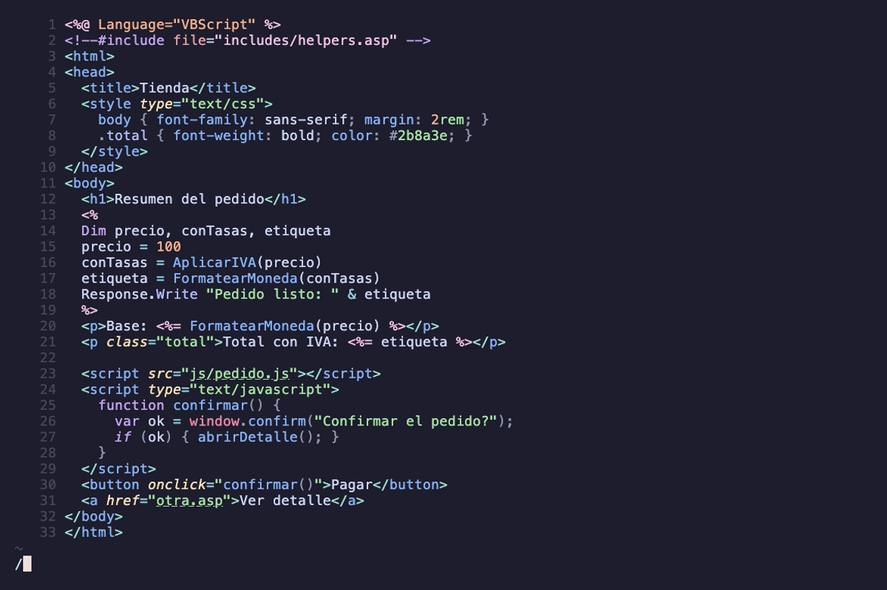
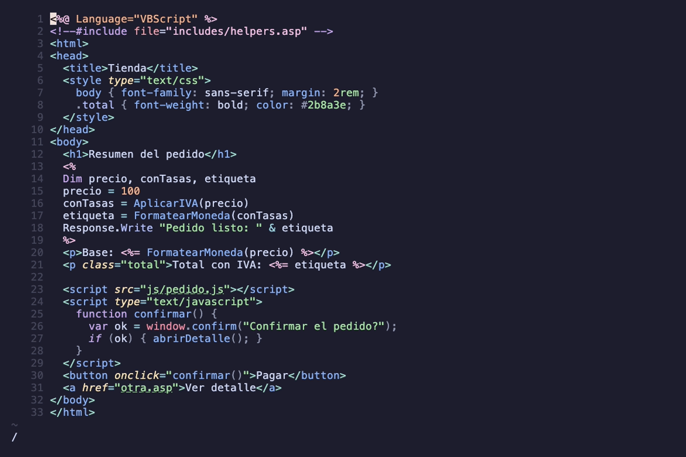

# asp.nvim

Soporte de Classic ASP (VBScript + HTML + JavaScript) para Neovim:
resaltado por regiones vía tree-sitter y navegación LSP (ir a definición,
referencias, símbolos, hover y completion) incluyendo la resolución de
`<!--#include -->` cross-file. Ver |asp.nvim| (`:help asp`) para el detalle.

El VBScript de `<% %>`/`<%= %>` se parsea con gramática propia
(`grammars/vbscript/`, fork de tree-sitter-vba), con resaltado de
keywords, tipos, funciones/variables y llamadas.

## Demo

Las tres capas (VBScript, HTML y JavaScript) resaltadas en un mismo `.asp`:


Ir a la definición a través de `<!--#include -->` (de `default.asp` a
`includes/helpers.asp`):



Hover con la doc de los intrínsecos y completion de sus miembros:



> Los GIFs se generan con [vhs](https://github.com/charmbracelet/vhs) desde
> `demo/*.tape` — ver [`demo/README.md`](demo/README.md).

## Requisitos

- Neovim >= 0.10
- `cc` y `git`: `make parsers` compila los parsers versionados en el repo.
  **No** necesitás tree-sitter CLI ni Node.js para instalar — el `parser.c`
  ya viene generado (ABI 14, compatible desde Neovim 0.10).
- Parsers `html`, `javascript` y `css` instalados (p. ej. con
  nvim-treesitter: `:TSInstall html javascript css`): asp.nvim no los
  compila para no pisar los que instale el usuario. `html` es necesario
  para el resaltado de las regiones HTML; `javascript`/`css` para el
  código de cliente dentro de `<script>`/`<style>`. `javascript` además
  habilita ir a definición/referencias en los `<script>` (sin él esa capa
  queda inerte y `:checkhealth asp` lo advierte).

## Instalación (lazy.nvim)

```lua
{
  'erikwco/asp.nvim',
  build = 'make parsers',
  ft = 'asp',
  opts = {},
}
```

## Navegación y ayuda al código

Al abrir un `.asp` se adjunta el servidor in-process `asp-ls`:

- **Ir a definición**: `C-]` (vía tagfunc) o `vim.lsp.buf.definition()` —
  Functions, Subs, Classes, variables y constantes del archivo actual,
  case-insensitive, con precedencia local → página.
- **JavaScript de cliente**: definición y referencias también dentro de los
  `<script>` del archivo: funciones, clases, métodos, `var`/`let`/`const`
  y parámetros, case-sensitive, con scope por función y un scope global
  compartido por todos los `<script>` de la página. Se ignoran
  `<script runat="server">`, los `type` que no son JavaScript
  (`text/template`, ...) y `<script language="VBScript">`; un `<%= %>`
  dentro del JS se trata como un valor opaco. Ver `:help asp-javascript`.
- **Abrir una página o recurso**: la misma consulta dentro de un literal
  entre comillas simples o dobles abre el archivo en su primera línea.
  Funciona en VBScript (`Response.Redirect "otra.asp"`), atributos HTML
  (`href`, `action`, `src`) y strings de JavaScript, sin depender de sus
  parsers. Incluye comillas anidadas, como
  `<a onclick="location.href='otra.asp'">` y enlaces en `Response.Write`.
  Admite `.asp`, `.inc`, `.htm`, `.html`, `.js` y `.css`, sin
  distinguir mayúsculas en la extensión. Ignora querystring, fragmento y
  espacios exteriores, así que `"otra.asp?id=" & id` también resuelve.
- **Símbolos del documento**: `vim.lsp.buf.document_symbol()` u outline de
  tu plugin favorito (aerial, Telescope `lsp_document_symbols`, ...). Las
  funciones y clases JS globales aparecen al final, con detail
  `javascript`.
- **Hover**: documentación de los objetos intrínsecos de ASP
  (`Response`, `Request`, `Server`, `Session`, `Application`) y firma de
  tus propias funciones/subs.
- **Completion**: miembros de los intrínsecos tras `Objeto.` (con
  `triggerCharacters` en `.`) y los símbolos del proyecto.

- **Cross-file**: definición y referencias siguen los
  `<!--#include file/virtual="..."-->` (recursivo, ciclos tolerados);
  `vim.lsp.buf.workspace_symbol()` busca en todo el proyecto.
- **Diagnósticos**: los includes que no resuelven se marcan con un
  warning en su línea. La raíz de los includes `virtual=` se autodetecta
  (`web.config` o `.git`) y puede fijarse con
  `require('asp').setup({ virtual_root = '/ruta/al/sitio' })`.

Las rutas de páginas que empiezan con `/` usan esa misma raíz virtual.
Las demás son relativas al directorio del archivo actual. Se normalizan
los separadores `\` a `/`. El destino debe existir y ser un archivo;
si no existe, la consulta devuelve `nil` sin agregar diagnósticos.
Se descartan `http://`, `https://`, `//`, `mailto:` y `javascript:`.

`gf` y `C-w f` usan `includeexpr` para resolver el nombre que Neovim extrae.
El ftplugin configura la expresión solo si está vacía y conserva cualquier
`includeexpr` previo del usuario. Neovim aplica la expresión cuando su
búsqueda normal no encuentra el archivo. `:find` no evalúa `includeexpr`;
para usar el resolver explícitamente:

```lua
local pages = require('asp.pages')
local path = pages.resolve('/includes/helpers.asp', vim.api.nvim_buf_get_name(0))
if path then vim.cmd.find(vim.fn.fnameescape(path)) end
```

> **Nota de rendimiento:** para los archivos INCLUDED/indexados (grafo de
> includes, `workspace/symbol`), la Fase 4 ya optimizó esto: solo se
> parsea la capa VBScript desde disco (milisegundos, incluso en archivos
> enormes), sin tocar html/js/css/regex. Esa optimización no cubre el
> buffer que tienes ABIERTO: en páginas muy grandes con muchos bloques
> `<script>` (miles de líneas), la *primera* consulta LSP tras abrir el
> archivo puede tardar varios segundos mientras tree-sitter parsea todas
> sus capas; las consultas siguientes sobre ese buffer son instantáneas.

## Limitaciones conocidas

- La navegación de páginas toma las comillas más cercanas a cada lado del
  cursor en una sola línea y exige que sean del mismo tipo.
  No evalúa expresiones ni URLs construidas en runtime, como
  `"pagina_" & id & ".asp"` o `"<%= destino %>"`. La detección es por texto,
  sin interpretar comentarios ni decodificar escapes de URL o de lenguaje.
  Los literales sí se detectan aunque haya varios `<%= %>` en esa línea.
- Con el cursor exactamente sobre una comilla, la definición LSP devuelve
  `nil`. `gf` puede abrir la página desde la comilla inicial.
- En sistemas sensibles a mayúsculas, `"Otra.asp"` no encuentra `otra.asp`
  y devuelve `nil`. IIS no distingue mayúsculas en los nombres de archivo.
- Las rutas relativas dentro de un `.inc` o una página incluida se
  resuelven contra el archivo que contiene la ruta, no contra la página
  que pidió el navegador. Es un límite de diseño del resolver compartido.
- `gf` y `C-w f` solo reconocen rutas con `/` como separador. Neovim corta
  el nombre en `\` en Unix. `C-]` y `vim.lsp.buf.definition()` sí normalizan
  `\` a `/`.
- Varios bloques `<%= %>` en una misma línea (p. ej.
  `<td><%=a%></td><td><%=b%></td>`) se fusionan en una sola región por la
  injection combinada de VBScript (necesaria para que construcciones
  cruzadas como `<% If %>...<% End If %>` parseen como un solo programa);
  como resultado, hover/definición/referencias no resuelven identificadores
  dentro de esos bloques adyacentes. Poné cada `<%= %>` en su propia línea
  para navegación LSP completa.
- JavaScript: sólo el archivo actual (no sigue `<script src>` ni includes);
  `let`/`const` se tratan como `var` (scope de función, no de bloque); las
  propiedades (`obj.metodo`, `this.x`, jQuery `$`) no se resuelven; no se
  recogen como declaración los nombres desestructurados, los parámetros
  con default o rest, el de `catch (e)` ni la variable de
  `for (const x of xs)`. Sin hover ni completion para JS.

## Verificación

`:checkhealth asp`

## Licencias

- El plugin (código Lua, gramática aspclassic, queries): **MIT**.
- `grammars/vbscript/`: **GPL-3.0** — fork de
  [arrmee-wt/tree-sitter-vba](https://github.com/arrmee-wt/tree-sitter-vba);
  cambios documentados en `grammars/vbscript/NOTICE.md`.

## Documentación y estado

- `:help asp` — referencia completa dentro de Neovim.
- `:checkhealth asp` — diagnóstico de parsers y del servidor.
- CI: la suite corre en Linux y macOS contra Neovim estable y nightly.
  Windows no está en la matriz (el build usa `make`/`cc`/`.so`, Unix-only);
  soporte Windows es backlog, requeriría un path de build separado.

El plugin cubre las cinco fases del diseño: resaltado de las tres capas,
gramática VBScript propia, navegación LSP, grafo de includes cross-file, y
ayuda al código (hover/completion) con documentación y CI.

## Desarrollo

El `parser.c` de cada gramática está versionado (por eso instalar sólo
necesita `cc`). Si editás una `grammars/*/grammar.js`, regenerá y commiteá:

```bash
make generate   # requiere Node.js; usa tree-sitter-cli 0.25.10, ABI 14
make test       # corpus + suite plenary
```

`make test` necesita red la primera vez: clona plenary.nvim,
tree-sitter-html y tree-sitter-javascript en `build/` y compila
`parser/html.so` y `parser/javascript.so` sólo para la suite.

El CI falla si el `parser.c` versionado quedó desactualizado respecto a su
`grammar.js`.
