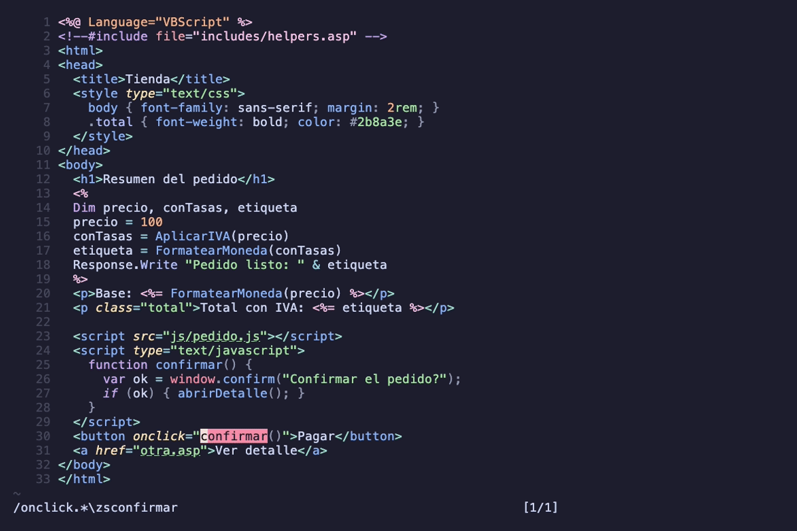

# asp.nvim

Soporte de Classic ASP (VBScript + HTML + JavaScript) para Neovim:
resaltado por regiones vía tree-sitter, plegado e indentación, y
navegación LSP (ir a definición, referencias, renombrar, símbolos, hover,
completion y signatureHelp) incluyendo la resolución de
`<!--#include -->` cross-file. Ver |asp.nvim|
(`:help asp`) para el detalle.

El VBScript de `<% %>`/`<%= %>` se parsea con gramática propia
(`grammars/vbscript/`, fork de tree-sitter-vba), con resaltado de
keywords, tipos, funciones/variables y llamadas.

## Demo

Las tres capas (VBScript, HTML y JavaScript) resaltadas en un mismo `.asp`:


Ir a la definición a través de `<!--#include -->` (de `default.asp` a
`includes/helpers.asp`):


Hover con la doc de los intrínsecos y completion de sus miembros:


Navegación desde un `onclick` a su función JS, apertura de páginas y
búsqueda de sus usos:



> Los GIFs se generan con [vhs](https://github.com/charmbracelet/vhs) desde
> `demo/*.tape` — ver [`demo/README.md`](demo/README.md).

## Requisitos

- Neovim >= 0.10
- `cc` y `git`: `make parsers` compila los parsers versionados en el repo.
  **No** necesitás tree-sitter CLI ni Node.js para instalar — el `parser.c`
  ya viene generado (ABI 14, compatible desde Neovim 0.10).
- Parsers `html`, `javascript` y `css` instalados (p. ej. con
  nvim-treesitter: `:TSInstall html javascript css`): asp.nvim no los
  compila para no pisar los que instale el usuario. `html` es necesario
  para el resaltado de las regiones HTML; `javascript`/`css` para el
  código de cliente dentro de `<script>`/`<style>`. `javascript` además
  habilita ir a definición/referencias en los `<script>` (sin él esa capa
  queda inerte y `:checkhealth asp` lo advierte).
  En Neovim 0.10, estos parsers deben usar ABI 13 o 14. Los de ABI 15
  no cargan, aunque estén instalados; `:checkhealth asp` los reporta
  como instalados pero con error de carga y muestra el error de Neovim.

Los parsers `aspclassic` y `vbscript` deben ser los de este repositorio.
Si otro plugin o instalador de nvim-treesitter instala un parser llamado
`vbscript`, el nombre coincide y Neovim carga el primero que encuentra
en `runtimepath`. Sus nodos pueden no ser compatibles con estas queries.
Podés localizar las copias con
`:lua vim.print(vim.api.nvim_get_runtime_file('parser/vbscript.*', true))`.
Compilá con `make parsers`, evitá que otro instalador sustituya esa copia
y reiniciá Neovim después de corregir el orden de `runtimepath`.
Si usás un instalador propio para esta gramática, incluí tanto `src/parser.c`
como `src/scanner.c` en la compilación.

### Resolver errores de ABI en Neovim 0.10

La rama [`main` de nvim-treesitter](https://github.com/nvim-treesitter/nvim-treesitter/tree/main)
exige Neovim 0.12 y compila parsers con ABI 15. Para usar Neovim 0.10,
fijá `branch = 'master'` en la configuración de nvim-treesitter y
reinstalá `html`, `javascript` y `css` con `:TSInstall! html javascript css`.
La rama `master` fija versiones de esos tres parsers con ABI 14,
que también cargan en Neovim 0.11+.

Si compilás los parsers por tu cuenta, regenerá sus fuentes con
`tree-sitter generate --abi 14` antes de compilarlos. Otra opción es
pasar a Neovim 0.11+ para cargar ABI 15; usar nvim-treesitter `main`
requiere Neovim 0.12.

Neovim 0.10 y 0.12 comparten `stdpath('data')/site/parser` por defecto.
Una actualización de parsers desde 0.12 puede dejar archivos ABI 15
que 0.10 no carga. Para separar las instalaciones, usá otro
`NVIM_APPNAME`, por ejemplo `NVIM_APPNAME=nvim-010 nvim`; ese nombre
también separa la configuración y los datos del editor.

## Instalación (lazy.nvim)

```lua
{
  'erikwco/asp.nvim',
  build = 'make parsers',
  ft = 'asp',
  opts = {},
}
```

## Navegación y ayuda al código

Al abrir un `.asp` se adjunta el servidor in-process `asp-ls`. Usá `C-]`
a través de `tagfunc` o `vim.lsp.buf.definition()` para ir a definición,
y `vim.lsp.buf.references()` para listar referencias.

### VBScript e includes

La navegación resuelve Functions, Subs, Classes, variables y constantes
sin distinguir mayúsculas, con precedencia local → página. Las referencias
de un símbolo local se limitan a su scope.

Definición y referencias siguen los `<!--#include file/virtual="..."-->`
de forma recursiva y toleran ciclos. Los includes que no resuelven se
marcan con un warning en su línea ([Diagnósticos](#diagnósticos)). La raíz de los includes `virtual=` se
autodetecta mediante `web.config` o `.git` y puede fijarse con
`require('asp').setup({ virtual_root = '/ruta/al/sitio' })`.

Las referencias de un símbolo de página (Function, Sub, Class, `Dim` o
`Const` fuera de un Sub/Function/Property) tienen alcance de sitio. Desde
una librería como `includes/helpers.asp`, `vim.lsp.buf.references()` lista
también los usos de las páginas que la incluyen, directa o transitivamente,
y de los demás includes de esas páginas: si una página incluye
`helpers.asp` y `lib/db.inc`, las llamadas desde `db.inc` también cuentan.
Desde una página que usa la función, el conjunto parte del include que la
declara, así que el resultado es el mismo que desde la librería.

En cada archivo se omiten los usos dentro de un Sub, Function o Property
que declara ese nombre como local o parámetro. Una página que no incluye la
librería no cuenta aunque use el mismo nombre. Una declaración de página
homónima en otro archivo del conjunto sí cuenta: al incluirse, ASP junta
todo en un único script y es la misma variable global, y en runtime gana la
última definición. La definición no cambia: sigue el buffer y sus includes.
El conjunto usa la raíz y el barrido de los [usos de una
página](#usos-de-una-página). Los includes del buffer consultado son los
de su contenido sin guardar; los de los demás archivos, los del disco. Un
include que se crea o se borra entra o sale del conjunto en la siguiente
consulta, también fuera de la raíz.

### JavaScript de cliente

Definición y referencias resuelven funciones, clases, métodos,
`var`/`let`/`const` y parámetros dentro de los `<script>` del archivo.
También funcionan en atributos de evento `on*`, como
`onclick="reinitAsk();"`, `onchange` y `onsubmit`, y en URLs
`href="javascript:..."`. Los atributos se reconocen en cualquier elemento,
sin distinguir mayúsculas; los nombres JS sí son case-sensitive.

Cada función tiene su scope. Los `<script>`, manejadores y URLs
`javascript:` comparten el scope global de la página. Cada manejador `on*`
es el cuerpo de una función, con sus `var` locales. Cada URL `javascript:`
es un script global, cuyas variables y funciones pertenecen a la página.

Ese global suma las funciones, clases y variables globales de los `.js`
de sus `<script src>`, y de los `<script>` y URLs `javascript:` de las
páginas incluidas con `<!--#include-->`. También incluye los `<script src>`
de esos includes. `C-]` abre la declaración en el archivo correspondiente
y `vim.lsp.buf.references()` reúne sus usos, incluidos los manejadores de
esas páginas. Ver `:help asp-javascript`.

Hover muestra la primera línea de la declaración o la firma de la función,
sin su cuerpo. Si viene de un `.js` o include, indica `Archivo:`.
Completion ofrece los bindings del scope más cercano, luego los globales
de la página y de sus externos, con prefijo sensible a mayúsculas. Las
palabras clave aparecen desde dos letras. Funciona también en `on*` y en
URLs `javascript:`.

`vim.lsp.buf.signature_help()` muestra los parámetros del árbol, incluidos
defaults, rest y patrones desestructurados. Detecta llamadas abiertas
dentro de la región JS, incluso en varias líneas y con llamadas anidadas.
Al contar argumentos ignora comas dentro de strings, templates, comentarios,
expresiones regulares, paréntesis, arrays y objetos.

El catálogo parcial DOM y ECMAScript tiene 102 entradas (84 miembros y 18
globales, sin contar alias de `window`). Aporta firmas y documentación en
español para `document`, `window`, `console`, `Math`, `JSON`, `localStorage`,
`location`, `navigator`, `history`, `Array` y funciones como `parseInt`.
Las tres ayudas usan ese catálogo. Los bindings del usuario lo sombrean.
Se reconocen rutas explícitas como `window.location.reload` y
`document.location.href`. Un `obj.` desconocido devuelve completion vacía.
No hay inferencia de tipos, alias, retornos ni miembros dinámicos de
formularios (`document.f`, `document.forms.f`, nombres o ids del HTML).
Los métodos del usuario tienen hover en su declaración, sin resolver
llamadas como `vista.pintar()`.

El handler elige VBScript o JS por las regiones ya indexadas. No mezcla
sus sugerencias ni ofrece ayuda dentro de strings o comentarios JS.
Completion y signatureHelp tratan todo template, incluida `${...}`, como
texto opaco. La ayuda reutiliza las cachés del buffer y de los externos;
las consultas en caliente no leen contenido de disco ni vuelven a parsear.
La medición reproducible está en [tests/bench/js_help.md](tests/bench/js_help.md).

Se ignoran `<script runat="server">`, los `type` que no son JavaScript,
como `text/template`, y `<script language="VBScript">`. Un `<%= %>` dentro
del JS se trata como un valor opaco.

### Páginas y recursos

La consulta de definición dentro de un literal entre comillas simples o
dobles abre el archivo en su primera línea. Funciona en VBScript
(`Response.Redirect "otra.asp"`), atributos HTML (`href`, `action`, `src`)
y strings de JavaScript, sin depender de sus parsers. Incluye comillas
anidadas, como `<a onclick="location.href='otra.asp'">`, y enlaces en
`Response.Write`.

Admite `.asp`, `.inc`, `.htm`, `.html`, `.js` y `.css`, sin distinguir
mayúsculas en la extensión. Ignora querystring, fragmento y espacios
exteriores, así que `"otra.asp?id=" & id` también resuelve.

Las rutas de páginas que empiezan con `/` usan esa misma raíz virtual.
Las demás son relativas al directorio del archivo actual. Se normalizan
los separadores `\` a `/`. El destino debe existir y ser un archivo;
si no existe, la consulta devuelve `nil` y el literal se marca con un
[diagnóstico](#diagnósticos).
Se descartan `http://`, `https://`, `//`, `mailto:` y `javascript:`.

`gf` y `C-w f` usan `includeexpr` para resolver el nombre que Neovim extrae.
El ftplugin configura la expresión solo si está vacía y conserva cualquier
`includeexpr` previo del usuario. Neovim aplica la expresión cuando su
búsqueda normal no encuentra el archivo. `:find` no evalúa `includeexpr`;
para usar el resolver explícitamente:

```lua
local pages = require('asp.pages')
local path = pages.resolve('/includes/helpers.asp', vim.api.nvim_buf_get_name(0))
if path then vim.cmd.find(vim.fn.fnameescape(path)) end
```

#### Usos de una página

`vim.lsp.buf.references()` dentro de un literal lista los enlaces y
directivas `<!--#include -->` que apuntan a ese archivo en todo el proyecto.
Fuera de un símbolo o literal de página, en un `.asp` o `.inc`, busca quién
usa el archivo abierto. Los resultados se ordenan por archivo, línea y
columna. Un literal de página irresoluble devuelve una lista vacía.

La búsqueda de usos recorre los archivos guardados `.asp`, `.inc`, `.htm`,
`.html` y `.js`. La raíz del barrido es `setup({ virtual_root = ... })` si
está fijada; si no, el `web.config` más externo hacia arriba desde el archivo;
si no hay ninguno, el `.git` más cercano. Un `admin/web.config` anidado no
oculta los enlaces desde otras carpetas del sitio. La resolución de rutas
`/virtual` conserva el `web.config` más cercano al archivo que contiene el
enlace, igual que los includes.

El barrido usa la ruta real de la raíz. Omite `build`, `node_modules` y las
carpetas ocultas, incluida `.git`, antes de descender. No sigue symlinks de
archivos ni de directorios dentro del sitio. Lee texto sin tree-sitter y
resuelve cada ruta contra el archivo que la contiene. Las directivas
respetan `file` o `virtual`, también cuando `virtual` no lleva `/` inicial.
La caché guarda candidatos normalizados por archivo, mtime, tamaño y raíz
virtual. Crear un destino después del primer barrido no requiere invalidarla.
Guardar una fuente invalida su entrada y cada barrido purga las fuentes
desaparecidas bajo esa raíz. Los cambios sin guardar no se incluyen.
Se quita el BOM UTF-8 y se convierte de latin1 si el texto no es UTF-8 válido.

Los nombres JS sin binding, como `document`, `alert` o `.title`, devuelven
una lista de referencias vacía. Los literales de página dentro de JS sí
consultan los usos del destino. Las referencias de símbolos VBScript
conservan la precedencia.

### Símbolos, hover, completion y firmas

- `vim.lsp.buf.document_symbol()` muestra el outline del archivo, también
  disponible desde aerial o Telescope `lsp_document_symbols`. Las funciones
  y clases JS globales aparecen al final, con detail `javascript`.
- `vim.lsp.buf.workspace_symbol()` busca símbolos VBScript en todo el proyecto.
- Hover muestra los intrínsecos de ASP (`Response`, `Request`, `Server`,
  `Session`, `Application`), funciones nativas con sus parámetros y retorno,
  constantes con su valor y tipos y miembros COM. También muestra declaraciones
  del usuario en la página y sus includes transitivos, con el archivo de origen.
- Completion ofrece funciones nativas, constantes y símbolos VBScript de la
  página y sus includes. Las palabras clave aparecen desde dos letras de prefijo.
  Después de `Objeto.` ofrece miembros intrínsecos o COM; si el objeto no
  tiene tipo conocido (una clase tuya, un COM fuera del catálogo), ofrece los
  símbolos del proyecto, sin nativos ni palabras clave. Dentro de
  `CreateObject("` y `Server.CreateObject("` ofrece ProgIDs del catálogo.
- `vim.lsp.buf.signature_help()` muestra firmas de funciones nativas,
  miembros intrínsecos y COM, y Subs, Functions y Properties del usuario.
  `textDocument/signatureHelp` anuncia `(` y `,` como disparadores y `,`
  como redisparador. Cuenta argumentos fuera de strings y paréntesis anidados;
  también reconoce `MiSub a, b` y `Call MiSub a, b` al comienzo de una sentencia.

La inferencia reconoce `Set x = Server.CreateObject("ProgID")`,
`Set x = CreateObject("ProgID")` y `Set x = New RegExp`. También sigue un
nivel de retorno COM, como `Set rs = conn.Execute(sql)` cuando `conn` se
creó directamente. Busca primero en la Sub, Function o Property actual,
después en la página y después en los includes, en el orden del grafo.
La primera asignación de cada nombre gana en el scope más cercano, incluso
si está después del cursor; `Set x = Nothing` no cuenta. No distingue
mayúsculas; acepta versiones como `ADODB.Recordset.6.0` y
`MSXML2.DOMDocument.6.0`. Un parámetro o `Dim` local sin tipo oculta el
nombre de página.

El catálogo COM es parcial: ADO, FileSystemObject y sus tipos derivados,
Dictionary, MSXML, CDO y RegExp. No inspecciona componentes instalados.
No infiere tipos para `Set x = funcionDelUsuario()`, ProgIDs calculados,
alias de variables ni cadenas de varios retornos COM. No analiza el flujo
de control ni cambios de tipo posteriores. Las llamadas activas se detectan
en la línea actual; no sigue continuaciones con `_`.

Los datos del buffer se invalidan al editar. Los includes comparten el
parseo de símbolos y diagnósticos, cacheado por mtime y tamaño e invalidado
al guardar. Las consultas en caliente no vuelven a leer su contenido.

### Resaltar ocurrencias del símbolo

`textDocument/documentHighlight` devuelve las ocurrencias de VBScript o
JavaScript en el buffer actual, respetando el scope de las referencias.
La declaración se marca como Write y los usos como Read; si no se resuelve
una declaración, se usa Text. No incluye los enlaces a páginas ni las
ocurrencias de otros archivos.

Podés activarlo desde tu plugin de LSP o con `vim.lsp.buf.document_highlight()`
en `CursorHold`. Este ejemplo limpia el resaltado al mover el cursor,
entrar en Insert o salir del buffer:

```lua
local group = vim.api.nvim_create_augroup('asp_document_highlight', { clear = true })
vim.api.nvim_create_autocmd('LspAttach', {
  group = group,
  callback = function(args)
    local client = vim.lsp.get_client_by_id(args.data.client_id)
    if not client or client.name ~= 'asp-ls' then return end
    vim.api.nvim_clear_autocmds({ group = group, buffer = args.buf })
    vim.api.nvim_create_autocmd('CursorHold', {
      group = group,
      buffer = args.buf,
      callback = vim.lsp.buf.document_highlight,
    })
    vim.api.nvim_create_autocmd({ 'CursorMoved', 'InsertEnter', 'BufLeave' }, {
      group = group,
      buffer = args.buf,
      callback = vim.lsp.buf.clear_references,
    })
  end,
})
```

El ejemplo se registra cuando se adjunta `asp-ls`, también en `.inc` y
extensiones en mayúsculas.

### Renombrar símbolos

`vim.lsp.buf.rename()` (o `grn` en Neovim 0.11+) renombra el símbolo
VBScript o JavaScript bajo el cursor en todos los archivos donde lo
encuentran las referencias. Antes de pedir el nombre nuevo,
`prepareRename` comprueba la posición; si no se puede renombrar, Neovim
muestra el motivo.

- VBScript: la página, sus includes y las páginas del sitio que incluyen
  la librería, directa o transitivamente, con el mismo alcance que [las
  referencias](#vbscript-e-includes). Los locales y parámetros cambian solo
  dentro de su Sub, Function o Property. Un cambio solo de mayúsculas
  (`total` → `Total`) es válido y unifica todas las ocurrencias.
- JavaScript: los `<script>` de la página, los atributos `on*`, las URLs
  `javascript:`, los `.js` de `<script src>` y los includes. Distingue
  mayúsculas. Conserva las claves de propiedades abreviadas: al renombrar
  `total` a `saldo`, `{total}` pasa a `{total: saldo}`, también en un
  parámetro desestructurado (`function f({total})`).

No se inicia el rename desde un acceso a miembro (`rs.EOF`, `obj.Total`,
`Me.Total`, `obj.metodo` en JS). No se renombran los intrínsecos de ASP, las
funciones, constantes y palabras clave nativas de VBScript, los globales
de JS sin declaración (`document`, un global implícito), los nombres de
VBScript sin declaración resoluble (sin `Dim` y sin `Option Explicit`),
los literales de página ni el HTML. Renombrar archivos está fuera de
alcance.

El nombre nuevo tiene que ser un identificador válido (VBScript:
`^[A-Za-z][A-Za-z0-9_]*$`, hasta 255 caracteres; JavaScript:
`^[A-Za-z_$][A-Za-z0-9_$]*$`) y distinto del actual. No puede ser una
palabra clave, un nativo ni un intrínseco (en VBScript, sin distinguir
mayúsculas) ni una palabra reservada de JavaScript. Se excluyen también
`eval` y `arguments`, que no pueden declarar nombres en JS estricto.

Un rename que dejaría el programa roto se rechaza, con un mensaje que dice
dónde está el problema:

- **El nombre nuevo ya existe**, en cualquier alcance. Juntaría dos
  símbolos en uno o taparía al renombrado: con
  `function f(dato) { return total; }`, renombrar `total` a `dato` haría
  que `f` devuelva su parámetro. En VBScript se miran las declaraciones
  del buffer, de su grafo de includes y de los archivos que cambia; los
  usos sin declaración del buffer (sin `Option Explicit`); y las
  declaraciones y usos de página de todos los archivos que recorren las
  referencias, incluidas las páginas del sitio que incluyen la librería
  aunque no usen el nombre viejo. En JavaScript, las declaraciones y los
  usos de cualquier scope de la página, sus `.js` y sus includes, también
  los globales sin declaración (`document`, `$`). Es conservador: rechaza
  también un nombre que solo coincide con un local de otra Sub o función.
  El mensaje da el `archivo:línea` para que elijas otro.
- **Un miembro de clase homónimo.** Si renombrar un nombre de página
  tocaría una clase que declara un miembro con ese nombre
  (`Private total`), en el archivo actual o en cualquier otro que
  cambiaría, el rename se rechaza: las referencias todavía no separan ese
  miembro del nombre de página y sus `Me.total` quedarían sin cambiar. El
  mensaje nombra la clase y el archivo. Renombrá primero el miembro desde
  adentro de la clase si es una variable `Private`; si es público, a mano.
- **Un miembro público de clase.** No se pueden resolver sus usos
  `obj.total` desde fuera de la clase. El rename se rechaza desde
  `prepareRename`, también para un `Dim` dentro de la clase, que es
  público. Renombralo a mano.
- **Un archivo a cambiar tiene cambios sin guardar.** Las posiciones de
  los demás archivos salen del disco: guardalo y volvé a renombrar.

Una variable de clase declarada con `Private` se renombra desde su
declaración o un uso suelto dentro de la clase. Cambia también sus usos
`Me.total`, sin distinguir mayúsculas, con espacios después del punto y
continuaciones `_`.
Solo cambia el buffer dentro de esa clase; conserva los locales y las
variables de página homónimos. Los métodos y las propiedades de clase se
renombran a mano.

Límites:

- No cambia los nombres dentro de strings de `Eval`, `Execute` o
  `ExecuteGlobal`, los nombres armados en runtime, los strings de
  JavaScript ni las páginas fuera de la raíz del sitio que incluyen la
  librería.
- Los comentarios, con apóstrofo o `Rem`, no cambian.

Neovim aplica el resultado abriendo los archivos de disco que cambia
como buffers modificados sin guardar. Revisalos y guardalos con `:wa`:

```vim
:lua vim.lsp.buf.rename()
:wa
```

### Resaltado semántico

`asp-ls` responde `textDocument/semanticTokens/full` y `/range`, y Neovim
los pide solo al adjuntarse el servidor y tras cada edición. Cada
identificador de VBScript o de JavaScript de cliente recibe el tipo de la
declaración a la que resuelve, con la misma resolución que la definición
y las referencias (local, página, miembro de clase e includes). Las
palabras clave, los literales, los strings, los comentarios y el HTML los
sigue resaltando tree-sitter: sobre ellos no hay tokens.

| Tipo | Qué marca |
|---|---|
| `function` | Functions, Subs, funciones JS y nativas como `Len` |
| `method` | Métodos de clases y llamadas como `Response.Write` |
| `class` | clases de VBScript y JS, también en `New Clase`, y `RegExp` |
| `property` | Miembros VBScript y propiedades como `Response.Buffer` |
| `variable` | Variables de página y locales, constantes y variables JS |
| `parameter` | parámetros de Sub, Function, Property y de funciones JS |
| `namespace` | Objetos intrínsecos de ASP y `Err` |

| Modificador | Qué marca |
|---|---|
| `declaration` | El nombre en su declaración, incluidos los parámetros |
| `readonly` | `Const` de VBScript, constantes nativas y `const` de JS |
| `defaultLibrary` | nativos de VBScript e intrínsecos de ASP |

Neovim aplica los grupos `@lsp.type.<tipo>.asp`, `@lsp.mod.<modificador>.asp`
y `@lsp.typemod.<tipo>.<modificador>.asp`
(ver `:help lsp-semantic-highlight`),
con prioridad sobre tree-sitter. Por defecto `@lsp.type.function` enlaza a
`@function`, `@lsp.type.parameter` a `@variable.parameter`, etc. Por ejemplo,
para distinguir los nativos y las constantes:

```lua
vim.api.nvim_set_hl(0, '@lsp.mod.defaultLibrary.asp',
  { link = '@function.builtin' })
vim.api.nvim_set_hl(0, '@lsp.typemod.variable.readonly.asp',
  { link = '@constant' })
```

Un miembro de objeto (`obj.Campo`) solo lleva tipo si el objeto es `Me` o
un intrínseco; el `.Campo` de un `With` y las propiedades de JS
(`obj.metodo`) no. Los métodos JS reciben tipo en su declaración.

En una página de 318 KB, la mediana de la primera llamada a `full` fue
53 ms en Neovim 0.12 y 80 ms en 0.10, con parsers y cachés vacíos.
En caliente fueron 5 y 8 ms; tras editar, 40 y 50 ms. Una de cinco
corridas de 0.10 tardó 207 ms en frío. El
[benchmark reproducible](tests/bench/semantic_tokens.md) detalla el método
y los rangos medidos.

Para apagarlo en una sesión, `:lua vim.lsp.semantic_tokens.stop(0,
vim.lsp.get_clients({ name = 'asp-ls' })[1].id)`. Para que el servidor no
lo anuncie:

```lua
require('asp').setup({ semantic_tokens = false })
```

### Diagnósticos

asp.nvim publica diagnósticos con `vim.diagnostic` (fuente `asp-ls`) en
cinco familias. El campo `code` de cada uno dice su familia:

- `includes`: directivas `<!--#include -->` que no resuelven y ciclos de
  includes.
- `syntax`: errores de sintaxis de VBScript, un diagnóstico por cada
  nodo `ERROR` o `MISSING` de la capa VBScript, con su rango. Solo dentro
  de los bloques `<% %>` y `<%= %>`: nunca sobre HTML ni JavaScript. Un
  error que sigue en el bloque siguiente se recorta al bloque donde empieza.
- `undeclared`: variables sin declarar cuando hay `Option Explicit` en la
  página o en alguno de sus includes. Un nombre está declarado si lo
  declara su Sub, Function o Property (también como parámetro), su clase,
  la página o cualquier archivo del grafo de includes, con `Dim`, `Const`,
  `Public`, `Private`, `Sub`, `Function`, `Property` o `Class`. En la
  página también cuentan `ReDim` y la variable de `For` y `For Each`. Se mira
  solo el nombre de la izquierda de `obj.Prop.Metodo`, sin distinguir
  mayúsculas. No se reportan los intrínsecos de ASP, `Err`,
  `ObjectContext`, `ASPError`, ni las funciones, constantes y palabras
  clave nativas de VBScript (`Len`, `Mid`, `CDate`, `vbCrLf`, `Me`...).
- `unknown_call`: llamadas a algo que no está declarado en la página ni en
  su grafo de includes y que no es nativo: `Nombre(args)`, `Call Nombre`,
  `Nombre arg1, arg2` como sentencia y `New Clase`. Un `x(1)` sobre un
  `Dim x(10)` es un índice, no una llamada. `New` solo acepta clases
  declaradas con `Class` y `RegExp`. Como `undeclared`, solo con
  `Option Explicit`.
- `missing_page`: literales de páginas y recursos (`.asp`, `.inc`, `.htm`,
  `.html`, `.js`, `.css`) cuyo destino no existe en disco. Usa la misma
  detección y la misma raíz virtual que la
  [navegación de páginas](#páginas-y-recursos). No marca literales con
  `<%` o `%>`, los que se concatenan con `&` o `+`, las URLs absolutas, los
  nombres sin base (`".asp"`) ni los literales dentro de comentarios HTML
  o VBScript.

Si la página o alguno de sus includes usa `Eval`, `Execute` o
`ExecuteGlobal`, no se revisan `undeclared` ni `unknown_call`: queda un
único HINT en la línea del primer uso, o en la directiva del include que
lo trae. Tampoco se revisan si algún include no resuelve: el nombre podría
estar declarado ahí.

Sin `Option Explicit`, VBScript declara una variable al asignarla, así que
un `x(0)` puede ser un arreglo creado así. Además, un archivo sin
`Option Explicit` suele ser una librería que llama a lo que declaran los
demás includes de la página que la incluye, y esos no se ven desde la
librería. Por eso esas dos familias necesitan `Option Explicit`.

#### Configuración

Cada familia acepta `'ERROR'`, `'WARN'`, `'INFO'`, `'HINT'`, un entero de
`vim.diagnostic.severity` o `false` para apagarla. `diagnostics = false`
apaga todas. Un valor inválido avisa una vez y usa el de por defecto.

```lua
require('asp').setup({
  diagnostics = {
    syntax = 'WARN',       -- por defecto: WARN
    undeclared = 'WARN',   -- por defecto: WARN
    unknown_call = 'WARN', -- por defecto: WARN
    missing_page = 'WARN', -- por defecto: WARN
    includes = 'WARN',     -- por defecto: WARN
  },
})
```

`syntax` fue HINT mientras la gramática marcaba como error construcciones
válidas de VBScript (`x Is Nothing`, `Case 1, 2`, `Const A = 1, B = 2`,
un `Case Else` vacío, `.Campo` dentro de un `With`, `Sub Foo` sin
paréntesis, `error = 1`, comentarios `Rem`). Desde 0.7 la gramática las
acepta y `syntax` es WARN: en los fixtures, en tres páginas reales y en 46
fragmentos válidos escritos a mano, uno por construcción, no queda ningún
falso positivo (con la gramática anterior eran 20 en 13 fragmentos).

Las variables y llamadas dentro de un error no se revisan, y los nombres
de una línea con un error cuentan como declarados en todo el buffer
actual. Esa recuperación de nombres no se aplica a los includes ni cubre
siempre las declaraciones partidas con `_`. `Case Is > 5` es sintaxis de
VBA, no de VBScript.

#### Cuándo se actualizan

Al abrir la página, al guardarla y 500 ms después de la última edición
(`TextChanged` e `InsertLeave`). Guardar un `.asp`, `.inc`, `.htm`,
`.html`, `.js` o `.css` vuelve a revisar las demás páginas abiertas.

`undeclared` y `unknown_call` usan el buffer con sus cambios sin guardar,
pero leen los includes desde disco: un include recién creado o editado
cuenta cuando se guarda.

Si se llama a `setup` con páginas ya abiertas, las severidades nuevas se
aplican en el próximo refresh. Se puede adelantar con
`require('asp.diagnostics').refresh(0)` en el buffer actual.

### Rendimiento

Los diagnósticos parsean solo el VBScript del buffer, con las regiones de
sus bloques `<% %>`, sin las capas HTML ni JavaScript. Los includes salen
de las cachés del grafo y de los símbolos, por mtime y tamaño. En una
página de ~20 KB con 20 includes, un refresh tarda ~5,6 ms en caliente,
sin leer disco, y ~21 ms en frío.
[Mediciones](tests/bench/diagnostics.md).

Las consultas VBScript sobre archivos de disco, como includes y símbolos
del proyecto, parsean sólo VBScript. En el buffer que tenés abierto,
tree-sitter también procesa las capas HTML, JavaScript, CSS y regex. En
páginas muy grandes con muchos bloques `<script>`, la primera consulta
puede tardar varios segundos. Las siguientes reutilizan los árboles,
aunque el costo de recorrer símbolos y ocurrencias crece con el archivo.

El resaltado recorre sólo las ocurrencias del buffer. Si la declaración
está allí, tampoco consulta archivos externos para clasificarla. Cuando
falta, busca la definición en includes o scripts externos para distinguir
un uso de un nombre sin declaración.
[Mediciones del resaltado frente a referencias](tests/bench/document_highlight.md).

El JavaScript de los `<script src>` y de los includes se lee desde disco
con parsers de HTML y JavaScript confinados a sus regiones. La caché usa
mtime y tamaño. Al terminar cada consulta vuelve a 64 archivos, descartando
los usados hace más tiempo, salvo los que usó esa consulta: si fueron más
de 64, los conserva todos. Olvida los borrados en la siguiente consulta.

El grafo de includes cachea las directivas de cada archivo por mtime y
tamaño, con el mismo criterio y un tope de 512 archivos. El destino de
cada include se resuelve en cada consulta, así que crear o borrar un
archivo incluido no requiere invalidar nada. En caliente, una definición
cross-file con 100 includes tarda ~1,8 ms en JS y ~1,7 ms en VBScript,
frente a 115 y 17 ms antes de agregar esta caché.
[Mediciones](tests/bench/includes_graph.md).

La primera búsqueda de usos de una página recorre y lee el sitio entero,
y puede tardar segundos. Las siguientes comprueban mtime y tamaño y sólo
releen archivos cambiados. Si la consulta lee al menos 2.000 archivos o
tarda un segundo, se emite un único aviso INFO con la cantidad de
archivos y el uso de caché en las siguientes consultas. Una consulta con
la caché caliente no avisa, aunque el sitio sea grande.

En Neovim 0.12.6 sobre Apple M4 Pro, 5.000 fuentes de unos 20 KB más el
destino y cinco JS minificados tardaron 3.334 ms en la primera consulta y
70 ms con caché, frente a 6.546 y 127 ms antes de optimizar el barrido.
Son medianas de cinco pares alternados, con 5.000 referencias verificadas
en cada consulta. Los archivos recién creados podían estar en la caché
del sistema operativo. [Mediciones y límites](tests/bench/pages_references.md).
Para repetir el caso con validación de rangos y lecturas:
`nvim --headless -u NONE --cmd 'set rtp+=.' -l tests/bench/pages_references.lua`.

Las referencias VBScript con alcance de sitio hacen ese mismo barrido y
reutilizan lo que leyó: cada archivo se lee una vez por consulta. Solo
parsean los archivos del conjunto que mencionan el nombre en su texto, y
de ellos solo la capa VBScript. De cada archivo parseado guardan las
ocurrencias de todos sus nombres por mtime y tamaño; de los demás, sus
palabras. Con la caché caliente, buscar otro símbolo no lee disco salvo
los archivos cambiados y los que recién ahora mencionan el nombre buscado.
Emiten el mismo aviso INFO que los usos de páginas.

Con 500 páginas de ~2,9 KB que incluyen una librería de 50 funciones, la
primera consulta tardó ~200 ms y las siguientes ~8 ms, también para otro
nombre y sin lecturas. La caché ocupó ~1,8 MB.

En un sitio grande, la primera consulta bloquea Neovim varios segundos.
Con 2.000 páginas de 20 KiB que usan todas el nombre buscado, tardó
~5,1 s: ~1,2 s de barrido y ~4 s de parsear las 2.000 páginas. Las
siguientes tardaron ~27 ms y la caché ocupó ~46 MB. Un nombre que ninguna
página usa tardó ~1,7 s en frío, porque no hace falta parsear ninguna.
Una página cambiada se relee sola.
[Mediciones](tests/bench/symbols_site.md).

## Plegado e indentación

### Plegado

El ftplugin fija `foldexpr` a `v:lua.vim.treesitter.foldexpr()`, el
plegado por tree-sitter de Neovim, con las queries `folds` del plugin. No
toca `foldmethod` ni `foldlevel`: para plegar, activalo en el buffer con
`:setlocal foldmethod=expr`, o para todas las páginas:

```lua
vim.api.nvim_create_autocmd('FileType', {
  pattern = 'asp',
  callback = function() vim.wo[0][0].foldmethod = 'expr' end,
})
```

Pliegan:

- Los bloques `<% %>` de más de una línea. Un `<%= %>` no pliega.
- En VBScript, `Sub`, `Function`, `Property`, `Class`, `If` de bloque,
  `For`, `For Each`, `Do`, `While`, `Select Case` y `With`. Un `If` de
  una línea (`If x Then y = 1`) no pliega.
- Un `<% If x Then %>` ... `<% End If %>` pliega el HTML de en medio. Lo
  mismo vale para `For`, `Do` y los demás bloques.
- Los elementos HTML, si tenés la query `folds` de html, por ejemplo la
  de nvim-treesitter.

Con `setup({ folds = false })`, asp.nvim no toca `foldexpr`.

### Indentación

El ftplugin fija `indentexpr` a `require('asp.indent').indentexpr()` y
ajusta `indentkeys`:

- El VBScript de un bloque `<% %>` de varias líneas se indenta desde la
  línea del `<%`, un nivel por cada bloque abierto según el árbol de
  tree-sitter. Las líneas con `End`, `Else`, `ElseIf`, `Case`, `Next`,
  `Loop` o `Wend` vuelven un nivel. `Select Case` indenta dos niveles,
  uno para el `Case` y otro para sus sentencias. La línea que sigue a un
  ` _` va un nivel más que la primera de la sentencia. Un `%>` solo en
  su línea se alinea con su `<%`.
- El HTML, incluidas las líneas con un `<% %>` o `<%= %>` de una sola
  línea, usa `HtmlIndent()` de Neovim (`indent/html.vim`), que también
  indenta el JavaScript de `<script>` y el CSS de `<style>`. Cada bloque
  VBScript que envuelve al HTML suma un nivel:

  ```asp
  <ul>
      <% For Each item In lista %>
          <li><%= item %></li>
      <% Next %>
  </ul>
  ```

  Se conserva la indentación del contenido de `<pre>`, incluso si
  contiene bloques ASP, como indica `HtmlIndent()`.
  Con el parser HTML también se conserva el contenido de `<textarea>`
  y los espacios antes de las etiquetas de cierre de ambos elementos.

- Mientras escribís, la línea se reindenta con `o` y `O` y al teclear
  `End`, `Else`, `ElseIf`, `Case`, `Next`, `Loop` o `Wend` al principio
  de la línea, sin distinguir mayúsculas. También se reindenta al teclear
  `%>` al principio de la línea o `>`, que cierra una etiqueta.
- Con código a medio escribir, cuando la línea o la anterior caen en un
  `ERROR` del árbol, la línea toma la indentación de la anterior no
  vacía. Suma un nivel si esa línea abre un bloque: termina en `Then` o
  empieza con `Sub`, `Function`, `For`, `Do`, `While`, `Select`, `With`,
  `Class`, `Property`, `Else` o `Case`. Resta uno si la línea actual
  cierra un bloque.

Con `setup({ indent = false })`, asp.nvim no toca `indentexpr` ni
`indentkeys`.

### nvim-treesitter

Es opcional. Si apagás la indentación de asp.nvim y usás la de
nvim-treesitter (`require('nvim-treesitter').indentexpr()`),
`queries/vbscript/indents.scm` aplica las mismas reglas de bloques. No
conoce las continuaciones ` _` ni anida el HTML dentro de un
`<% If %>`. La suite prueba el indentexpr de asp.nvim, no esta query.

### Rendimiento de la indentación

asp.nvim cachea lo que saca del árbol por `changedtick`. Neovim no lo
incrementa durante `=`, así que en `gg=G` asp.nvim no vuelve a parsear
y su parte crece lineal con la página. En una página sintética de 307 KB,
`gg=G` tarda ~6,9 s en frío, con ~0,1 s de asp.nvim y ~2,7 s de
`HtmlIndent()`. Neovim usa los
otros ~4 s para reajustar los rangos de las capas inyectadas en cada
línea editada; ese costo lo paga cualquier edición masiva del buffer.
En una página real de 318 KB con 6.850 líneas de JavaScript tarda
~16 s, casi todo en el indent de JavaScript de Vim. La misma página con
`ft=html` tarda ~20 s. El indentexpr al abrir con `o` tarda ~1–2 ms en
VBScript de la página real y ~18 ms en la sintética; en HTML llega a
~45 ms con Neovim 0.10. Son tiempos del indentexpr, no de toda la tecla.
[Mediciones](tests/bench/indent.md).

### Límites

- Un `If` que abre en un bloque `<% %>` de varias líneas y cierra en
  otro cruza los pliegues de esos bloques. Vim exige que los pliegues se
  aniden, así que los niveles quedan cortados. Con `<% If %>` y
  `<% End If %>` en líneas propias no pasa.
- `vim.treesitter.foldexpr()` sólo pliega las capas inyectadas ya
  parseadas, y recalcula al cambiar el árbol de la plantilla. asp.nvim
  parsea la capa vbscript al abrir la página; después la reparsea el
  resaltado al redibujar. Si eso ocurre después de recalcular, un
  pliegue nuevo de VBScript aparece con la edición siguiente.
- Con `HtmlIndent()` vienen sus límites. El JavaScript de un `<script>`
  lo indenta el indent de JavaScript de Vim, lento en páginas con mucho
  JS. Sus comentarios `/* */` de varias líneas pueden cambiar de
  indentación entre una pasada de `gg=G` y la siguiente.
- El respaldo por texto reconoce un `If` de bloque sólo si su línea
  termina en `Then`: no abre nivel tras un `If x Then:` cuyas sentencias
  siguen en las líneas de abajo.

## Limitaciones conocidas

- Diagnósticos de VBScript: no ven lo que declara `global.asa` (objetos
  `<OBJECT>`, type libraries con `METADATA`) ni los bloques
  `<script runat="server">`. Bajo `Option Explicit`, sus nombres y las
  constantes de ADO sin `adovbs.inc` se marcan como sin declarar. La
  variable de un `For` cuenta como declarada aunque VBScript exige su
  `Dim`. Una página con `<%@ Language="JScript" %>` no se revisa como
  VBScript.
- Páginas inexistentes: la detección es la de la navegación, por texto.
  No reconoce comentarios de JavaScript y marca cualquier literal con una
  de esas extensiones, aunque no sea un enlace, como un archivo que se va a
  crear con `Server.MapPath`. En un filesystem sensible a mayúsculas,
  `"Otra.asp"` no encuentra `otra.asp`, aunque IIS sí lo serviría.

- La navegación de páginas toma las comillas más cercanas a cada lado del
  cursor en una sola línea y exige que sean del mismo tipo.
  No evalúa expresiones ni URLs construidas en runtime, como
  `"pagina_" & id & ".asp"` o `"<%= destino %>"`. La detección es por texto,
  sin interpretar comentarios ni decodificar escapes de URL o de lenguaje.
  Los literales sí se detectan aunque haya varios `<%= %>` en esa línea.
- Con el cursor exactamente sobre una comilla, la definición LSP devuelve
  `nil`. `gf` puede abrir la página desde la comilla inicial.
- La comparación respeta el filesystem. En APFS sin distinción de mayúsculas,
  `"Otra.asp"` y `"otra.asp"` reúnen los mismos usos. En un filesystem sensible
  a mayúsculas son destinos distintos. La comparación usa la ruta real tras
  filtrar por el nombre base en minúsculas; no reúne aliases por symlink con
  nombres base diferentes ni hard links. Una raíz por symlink sí funciona.
- Las directivas `<!--#INCLUDE FILE=...-->` en mayúsculas no las reconoce la
  gramática actual. El barrido puede detectar su texto como un literal, pero
  no garantiza la semántica `file` o `virtual` de esas directivas.
- Las rutas relativas dentro de un `.inc` o una página incluida se
  resuelven contra el archivo que contiene la ruta, no contra la página
  que pidió el navegador. Es un límite de diseño del resolver compartido.
- Las referencias VBScript con alcance de sitio no siguen `Server.Execute`,
  `Server.Transfer` ni includes armados en runtime. Solo conocen los
  incluidores dentro de la raíz del barrido; un include fuera de ella se
  recorre con su grafo. Los demás archivos se leen de disco, sin los cambios
  sin guardar de otros buffers. Los usos se buscan por nombre, así que un
  miembro `obj.Total` cuenta como uso de un `Total` de página, igual que antes.
  El [rename](#renombrar-símbolos) los omite.
- `gf` y `C-w f` solo reconocen rutas con `/` como separador. Neovim corta
  el nombre en `\` en Unix. `C-]` y `vim.lsp.buf.definition()` sí normalizan
  `\` a `/`.
- Gramática de VBScript: un `.` con un blanco antes empieza un `.Campo`
  de `With`, como en VBScript (`Response.Write .Campo`): `obj .Campo` no
  es un acceso. `obj _` seguido de `.Campo` en la línea siguiente sí lo es.
- JavaScript entre archivos: de cada `.js` de `<script src>` y de cada
  include sólo se ven sus declaraciones globales. Gana el buffer, luego
  los `<script src>` en orden y después los includes en el orden del
  grafo. Si varios archivos declaran el mismo global, la definición va
  al de mayor prioridad y las referencias los reúnen a todos (en el
  navegador son la misma variable). Se ignoran los `src` externos (`http://`, CDN),
  inexistentes o armados con `<%= %>`; no se siguen `import`/`export`.
  Abrir un `.js` suelto no activa `asp-ls`: ahí va tu LSP de JavaScript.
- JavaScript: `let`/`const` se tratan como `var` (scope de función, no de
  bloque); las propiedades (`obj.metodo`, `this.x`, jQuery `$`) no se
  resuelven; no se recogen como declaración el parámetro de `catch (e)`
  ni la variable de `for (const x of xs)`. Los parámetros con default,
  rest o desestructurados y los nombres desestructurados de `var`, `let`
  y `const` sí. Los defaults ven los parámetros y los alcances externos,
  sin las declaraciones del cuerpo de su función. Hover, completion y
  signatureHelp cubren bindings y el catálogo DOM parcial; no infieren
  miembros de objetos del usuario ni formularios por nombre o id.
- JavaScript en manejadores `on*`: no se modela el parámetro implícito
  `event` ni la cadena de scopes del elemento y su formulario
  (`onclick="submit()"` no resuelve a `form.submit`). No se decodifican
  las entidades HTML (`&quot;`) ni los `%xx` de una URL `javascript:`:
  ahí el JS queda con un error de sintaxis y el resto resuelve igual.
  Un manejador con `language="vbscript"` (IE) se lee igual como JS. No
  se ven los manejadores que arma VBScript (`Response.Write "<a
  onclick=...>"`) ni un `href` cuyo prefijo `javascript:` viene de un
  `<%= %>`.

## Licencias

- El plugin (código Lua, gramática aspclassic, queries): **MIT**.
- `grammars/vbscript/`: **GPL-3.0** — fork de
  [arrmee-wt/tree-sitter-vba](https://github.com/arrmee-wt/tree-sitter-vba);
  cambios documentados en `grammars/vbscript/NOTICE.md`.

## Documentación y estado

- `:help asp` — referencia completa dentro de Neovim.
- `:checkhealth asp` — diagnóstico de parsers y del servidor.
- CI: la suite corre en Linux y macOS contra Neovim 0.10.4, estable y nightly.
  Windows no está en la matriz (el build usa `make`/`cc`/`.so`, Unix-only);
  soporte Windows es backlog, requeriría un path de build separado.

La versión 0.6.0 incluye:

- Resaltado de VBScript, HTML y JavaScript, con gramática VBScript propia.
- Navegación VBScript en el archivo y a través del grafo de includes.
- Apertura de páginas y recursos por literal, `gf` y `C-w f`.
- Búsqueda de usos de páginas en todo el sitio.
- Navegación JavaScript en el archivo, en `.js` e includes, en manejadores
  `on*` y en URLs `javascript:`.
- Hover de los objetos intrínsecos de ASP y de las firmas de tus funciones
  y subs de VBScript. Completion de miembros intrínsecos y símbolos del proyecto.
- Diagnósticos de includes y búsqueda de símbolos.
- `documentHighlight` para las ocurrencias VBScript y JS del buffer actual.
- CI en Neovim 0.10.4, estable y nightly, sobre Linux y macOS.

## Desarrollo

El `parser.c` de cada gramática está versionado (por eso instalar sólo
necesita `cc`). Si editás una `grammars/*/grammar.js`, regenerá y commiteá:

```bash
make generate   # requiere Node.js; usa tree-sitter-cli 0.25.10, ABI 14
make test       # corpus + suite plenary
```

`make test` necesita red la primera vez: clona plenary.nvim,
tree-sitter-html y tree-sitter-javascript en `build/` y compila
`parser/html.so` y `parser/javascript.so` sólo para la suite.
tree-sitter-javascript va pineado al tag `v0.23.1` (ABI 14): su rama
principal genera ABI 15, que Neovim 0.10 no carga.

Para probar otro Neovim, pasá su ruta en `NVIM`:

```bash
make test NVIM=/ruta/a/nvim
```

Para medir la ayuda en caliente con una página sintética de 20 KiB y 20
includes, corré el benchmark con el mismo inicio aislado de la suite:

```bash
nvim --headless -u tests/minimal_init.lua \
  -c "lua dofile('tests/bench_help.lua')"
```

Imprime medianas, p95, cantidad de resultados y contadores de lecturas y
parseos de disco. Comprueba los resultados de cada consulta y elimina sus
archivos temporales al terminar.

El harness desactiva ShaDa con `vim.o.shadafile = 'NONE'` para que los
procesos de prueba no lean ni escriban el estado del desarrollador.

El CI falla si el `parser.c` versionado quedó desactualizado respecto a su
`grammar.js`.
